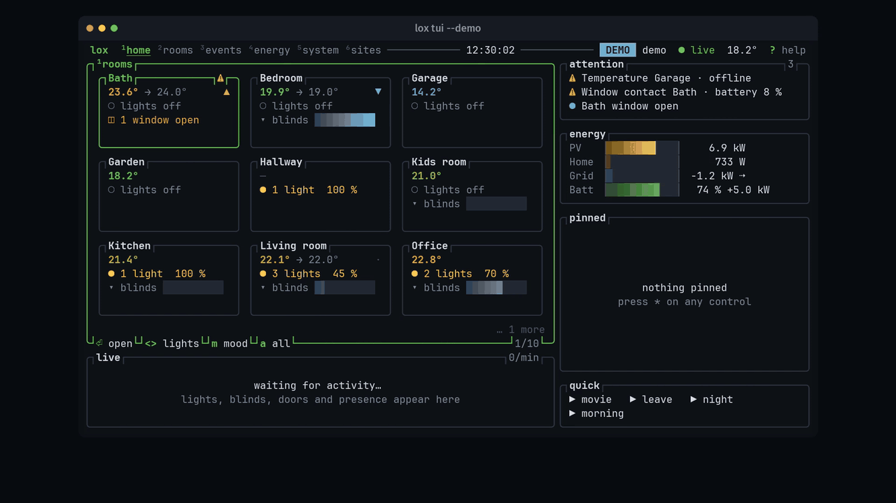

# lox — Loxone Miniserver CLI

[](https://github.com/discostu105/lox/actions/workflows/ci.yml)
[](https://github.com/discostu105/lox/actions/workflows/release.yml)
[](LICENSE)
[](https://www.rust-lang.org/)
[](https://codecov.io/gh/discostu105/lox)

`lox` controls, monitors and manages a [Loxone](https://www.loxone.com) Miniserver from the terminal.
It talks to the Miniserver directly over your local network: no cloud, no runtime, one ~4 MB binary for
Windows, macOS and Linux.

The Loxone app is made for tapping on a phone. `lox` covers what it can't: scripts, cron jobs, headless
machines, AI agents, and treating the Miniserver config like source code.

```bash
lox on "Licht Wohnzimmer"                        # switch a light
lox blind "Beschattung Süd" pos 70               # move a blind
lox get "Temperatur [Schlafzimmer]"              # read a sensor
lox if "Temperatur Außen" gt 28 && lox blind "Beschattung Süd" pos 70
lox tui                                          # live terminal UI
```

## What it can do

| | |
|---|---|
| **Control** | Lights, moods, dimmers, colors, blinds, gates, thermostats, alarms, door locks, intercoms, wallboxes, virtual inputs, scenes. Controls are found by name, no UUIDs. |
| **Monitor** | Sensors, energy meters, statistics, device health (batteries, signal, offline devices), a real-time state stream, OpenTelemetry export. |
| **Terminal UI** | `lox tui`: a full-screen live view of the house, with rooms, events, energy flow, system stats and the config wiring behind each control. |
| **AI agents** | JSON output and exit codes on every command, `--dry-run`, a command schema, and an MCP server (`lox mcp serve`) for Claude, ChatGPT, Cursor and others. |
| **Config versioning** | Download the Miniserver config into git on a schedule, with commit messages that list the logic that changed. Diff, inspect and restore any version. |
| **Config as code** | Write logic in `.lxir` text files, review it in a pull request, compile it into the config and deploy it with a verified upload. |
| **Access** | NFC tags and access codes for users, the door access log, and *why can't this user open the door?* |

## Contents

- [Install](#install) · [Setup](#setup)
- [Controlling the home](#controlling-the-home) · [Terminal UI](#terminal-ui) · [AI agents and MCP](#ai-agents-and-mcp)
- [Config versioning](#config-versioning-gitops) · [Config as code](#config-as-code-lxir)
- [Configuration reference](#configuration-reference) · [Requirements](#requirements)
- [Documentation](#documentation) · [Related projects](#related-projects) · [Status](#status) · [License](#license)

---

## Install

**Homebrew (macOS, Linux)**
```bash
brew tap discostu105/lox https://github.com/discostu105/lox
brew install discostu105/lox/lox
```

**Windows (PowerShell)**
```powershell
irm https://raw.githubusercontent.com/discostu105/lox/main/install.ps1 | iex
```
This puts the latest release in `%LOCALAPPDATA%\lox` and adds it to your PATH. To install by hand, download
`lox-windows-x86_64.exe` from the [latest release](https://github.com/discostu105/lox/releases/latest), rename it
to `lox.exe` and put it on your PATH.

**From source** (Rust 1.91+, no OpenSSL needed)
```bash
git clone https://github.com/discostu105/lox
cd lox
cargo build --release      # → target/release/lox
```

## Setup

```bash
lox setup set --host https://192.168.1.100 --user USER --pass PASS
lox status                 # check the connection
lox ls                     # list the controls lox can see
```

To keep the password out of your shell history and the process list, use `LOX_PASS` instead of `--pass`:
`read -rs LOX_PASS && export LOX_PASS`. More options (several Miniservers, aliases, completions) are under
[Configuration reference](#configuration-reference).

---

## Controlling the home

Names are matched as case-insensitive substrings. When a name matches several controls, add the room with
`--room` or as `"Name [Room]"`.

```bash
lox ls -t Jalousie -r "EG"                 # filter by type, room, category
lox get "Temperatur" --room "Schlafzimmer" # read a control's state
lox on "Licht Wohnzimmer"                  # on / off
lox light mood "Wohnzimmer" plus           # next light mood
lox thermostat "Heizung" temp 22.5         # set the temperature
lox alarm "Alarmanlage" arm                # arm the alarm
lox sensors --type door-window             # open windows and doors
lox energy                                 # energy meters
lox health --problems                      # low batteries, weak signal, offline devices
lox run abend                              # run a scene
lox stream --room "Kitchen" -o json        # state changes as they happen
lox otel serve --endpoint http://…         # push metrics, logs and traces via OTLP
```

| Control type | Commands |
|------|----------|
| `LightControllerV2` | `on`, `off`, `light mood <name> plus/minus/off/<id>`, `light moods <name>` |
| `Jalousie` / `CentralJalousie` | `blind <name> up/down/stop/shade/pos <0-100>` |
| `Switch` / `Pushbutton` | `on`, `off`, `input pulse` |
| `Dimmer` | `light dim <name> <0-100>` |
| `ColorPickerV2` | `light color <name> "#RRGGBB"` / `"hsv(h,s,v)"` / `"temp(brightness,kelvin)"` |
| `Gate` / `CentralGate` | `gate <name> open/close/stop` |
| `IRoomControllerV2` | `thermostat <name> temp <°C>` / `mode <auto…>` / `override <°C> [min]` |
| `Alarm` | `alarm <name> arm/arm-home/disarm/quit` |
| Door lock, intercom, wallbox | `door … lock/unlock/open`, `intercom … answer/hangup/open`, `charger … start/stop/pause` |
| Analog / virtual inputs | `input set <name> <value>` |
| Sensors, meters | `get`, `sensors`, `energy`, `history` (read-only) |
| Any | `send <name> <raw-command>`, `lock`, `unlock` |

**Scenes** are YAML files in `~/.lox/scenes/`, run with `lox run <name>`:

```yaml
# ~/.lox/scenes/abend.yaml
name: Abend
steps:
  - control: "Lichtsteuerung Wohnzimmer"
    cmd: on
  - control: "Beschattung Südseite"
    cmd: "pos 70"
  - control: "LED Küche"
    cmd: off
    delay_ms: 500
```

**Users and door access**

```bash
lox access check alice                 # why alice may (not) open the NFC Code Touch
lox access log "Code Touch"            # who opened when, denied attempts
lox access learn "Code Touch" --user alice --name "alice phone"  # read an NFC tag, pair it
lox user code set alice                # new access code (hidden prompt)
```

Every command and flag is in **[COMMANDS.md](COMMANDS.md)**.

---

## Terminal UI

`lox tui` is a full-screen, keyboard-driven live view of your installation, like btop for your house.



<sub>Recorded from `lox tui --demo` with [scripts/demo-video](scripts/demo-video/). No Miniserver needed.</sub>

```bash
lox tui                 # connect to the current context
lox tui --demo          # a synthetic demo house
lox tui --read-only     # wall display: look, don't touch
```

- **Home**: room cards, what needs attention (open windows, low batteries, offline devices), pinned controls, a live feed
- **Rooms**: every control with its live value; `␣` toggles, `+`/`-` dims, `=` sets a value, `m` picks a mood, `a` shows all actions
- **Events**: every state change as it happens, filterable, with what happened just before
- **Energy**: animated PV / home / grid / battery flow, meters, today's curve
- **System**: CPU, heap, devices, CAN bus and LAN, the Miniserver log, and config history with logic diffs
  (`⏎` browses a snapshot, `m` compares two commits, `w` opens a changed block's wiring)
- **Sites**: all your Miniservers at a glance; switch live
- **Wiring** (`w`): the config program around a control with live values on the wires, to answer *why is this
  light on?* `t` traces the path to the sensors or actuators, `H` shows the block's history
- **History** (`c`): a control's statistics over 6 h to a year, with period compare, a cursor and extra series

`:` opens a fuzzy palette for rooms, controls, scenes and any `lox` command, `?` lists the keys, and `y` copies
the equivalent `lox` command. Doors, alarms, gates and controls on your `confirm:` list ask before acting;
reboot and update ask you to type the context name. All keys and flags:
[COMMANDS.md](COMMANDS.md#terminal-ui).

---

## AI agents and MCP

Every command exits `0` on success and non-zero on error, and `-o json` gives structured output (errors too,
as JSON envelopes with error codes). An agent with a shell tool can discover the house and act on it without
a custom integration:

```bash
lox schema -o json                    # discover the commands
lox ls -o json                        # discover the controls
lox --dry-run on "Licht" -o json      # preview before executing
lox --trace-id "run-42" on "Licht"    # execute, correlated in the logs
lox health --problems -o json         # check device health
```

`--non-interactive` fails instead of prompting (implied by `-o json`).

**MCP server.** Clients that speak the [Model Context Protocol](https://modelcontextprotocol.io) (Claude
Desktop, Claude Code, ChatGPT, Cursor, …) can launch `lox mcp serve`. It exposes typed tools over stdio:
rooms, controls, live state, switches, blinds, lights, climate, scenes, the config wiring behind a control,
door access, learning NFC tags and setting access codes. Doors, gates, the alarm, every change to users and
any control on your `confirm:` list ask you to confirm in the client before anything is sent.

```bash
lox mcp config                           # print a ready-to-paste client config
claude mcp add loxone -- lox mcp serve   # Claude Code
lox mcp tools                            # the tools a client will see
```

Tool list and safety model: [AI agent guide](docs/guides/ai-agents.md#mcp-server).

---

## Config versioning (GitOps)

Keep the Miniserver configuration in a git repository, with one commit per change:

```bash
lox config init ~/loxone-config               # one-time setup
lox config pull                               # download, diff, commit (--quiet for cron)
lox config log                                # history
lox config restore abc123 --force && lox reboot --yes   # back to an old version
```

Each pull downloads the config over FTP, decompresses Loxone's LoxCC format to XML, diffs the logic (blocks,
parameters and wires, per page) against the previous snapshot and writes it into the commit message:

```
[504F94AABBCC] Config backup 2026-03-08 18:22:56 (v42)

= 1 added · 1 parameter · wires +1 −0

# Garage
+ block  Garage light (Switch)
~ param  Garage door · Runtime  20 s → 25 s
+ wire   Motion Garage.Q → Garage light.Tg
```

Every snapshot stays inspectable:

```bash
lox config diff v271                   # what changed in the logic since version 271
lox config wiring "Licht" --trace up   # what drives this light, back to the sensors
lox config show -p Wohnzimmer          # a logic page as lxir source
lox config find bewegung               # search blocks by name, type, device, room
lox config lint                        # dead blocks, unwired inputs and motors, duplicate names
lox config history "Licht"             # how one block changed over time
```

`--at v42` runs `show`, `wiring`, `find` and `lint` on an old snapshot. Each Miniserver gets its own
subdirectory (by serial number). A restore uploads the original backup ZIP from git as `sps_new.zip`, without
recompressing it, and the Miniserver loads it on its next start.

Guide: [Config versioning](docs/guides/config-versioning.md).

---

## Config as code (lxir)

Write Miniserver logic as text, review it in a pull request, and compile it into the real config:

```text
temp_hoch = GreaterEqual("Temp über 28", Input1: aussentemp.Q, Input2: 28)
jal_sued.AutoShade <- temp_hoch.Q and sonne.Q
```

- `lox ir compile` writes the same XML Loxone Config would have written, and pins every UUID it creates in a
  lockfile, so the next compile changes only what you changed.
- Everything the source doesn't manage (hardware, rooms, visualization, other logic) passes through byte for
  byte. `lox ir diff` shows it.
- `lox ir drift` tells you when Loxone Config or the app changed the config since.
- `lox ir coverage` shows how much of the config the source owns.
- `lox config push --force` deploys a project: drift check, compile against the live config, a check for user
  changes the upload would discard, byte-exact upload, restart, and a download that confirms the Miniserver
  runs the compiled file.
- `lox ir lsp` is a language server for your editor.
- `lox ir templates` ships tested templates for common automations, and `lox ir types --search` says what
  each block type is for.

```bash
lox config download --extract --save-as base.zip   # the deployed config → base.Loxone
lox ir adopt base.Loxone --out-dir pages --out-lock lxir.lock.json   # take over existing blocks
$EDITOR pages/*.lxir                                # with base, module and lock in lox.toml:
lox ir compile && lox config diff base.Loxone out.Loxone
lox config push --force                             # deploy, verified
```

Walkthrough: [Config as Code guide](docs/guides/config-as-code.md). Reference:
[COMMANDS.md](COMMANDS.md#config-as-code-lxir) and the [lxir docs](crates/lxir/README.md).

The toolchain is the [`lxir`](crates/lxir) crate in this repository, a library without network access (also on
[crates.io](https://crates.io/crates/lxir)). `lox` uses it for `lox ir`, the logic diffs, the TUI's Wiring view
and `lox config show/wiring/find/lint/history`.

---

## Configuration reference

The config lives in `~/.lox/config.yaml` (Windows: `C:\Users\<YOU>\.lox\config.yaml`). `--serial` in
`lox setup set` is optional: it names the Miniserver's folder in the config repo and its OpenTelemetry
`device.id`.

**Several Miniservers**: named contexts.

```bash
lox ctx add home --host https://192.168.1.100 --user admin --pass secret
lox ctx add office --host https://10.0.0.50 --user admin --pass secret
lox ctx use home              # switch the active context
lox --ctx office status       # one command against another context
```

**Aliases**: short names for controls you use often.

```yaml
host: https://192.168.1.100
user: admin
pass: secret
aliases:
  wz: "1d8af56e-036e-e9ad-ffffed57184a04d2"     # Lichtsteuerung Wohnzimmer
  kueche: "20236c09-0055-6e94-ffffed57184a04d2" # Licht Küche Insel
```

Then `lox on wz`, `lox off kueche`.

**Shell completions**: Homebrew installs them. Otherwise run `lox completions --install` (detects your
shell), or print them with `lox completions bash|zsh|fish|powershell`. For PowerShell, add this to `$PROFILE`:

```powershell
lox completions powershell | Out-String | Invoke-Expression
```

**Files**

```
~/.lox/
  config.yaml          # host, credentials, aliases, confirm: list (one Miniserver or named contexts)
  tui.yaml             # lox tui preferences
  contexts/<name>/     # per context (a single-Miniserver config keeps these directly in ~/.lox/)
    cache/structure.json   # LoxApp3.json (24 h TTL, ~150 KB)
    token.json         # token auth (optional)
    scenes/*.yaml      # your scenes
```

**Caching**: the structure file (`LoxApp3.json`) is cached for 24 h. Run `lox cache refresh` after you change
the config in Loxone Config.

| Operation | Cold cache | Warm cache |
|-----------|------|------|
| `lox on "Licht"`, `lox ls` | ~1.2 s | ~80 ms |
| `lox ls --values` | ~1.2 s + one request per control | one request per control |
| `lox status` | ~120 ms | ~120 ms |

---

## Requirements

- Loxone Miniserver Gen 1 or Gen 2, firmware 12.0+
- Network access to the Miniserver (local, or DynDNS)
- An admin user for `lox log`
- Windows (x86_64, ARM64), macOS (x86_64, Apple Silicon), Linux (x86_64, ARM64)

TLS uses rustls; the Miniserver's self-signed certificate is accepted unless you set `verify_ssl: true`.

## Documentation

- [COMMANDS.md](COMMANDS.md): every command and flag
- [Getting started](docs/getting-started.md)
- Guides: [AI agents](docs/guides/ai-agents.md), [Terminal UI](docs/guides/tui.md),
  [Config versioning](docs/guides/config-versioning.md), [Config as code](docs/guides/config-as-code.md),
  [Scenes](docs/guides/scenes.md), [OpenTelemetry](docs/guides/opentelemetry.md)
- [Architecture](docs/architecture.md) and [contributing](docs/contributing.md)
- The docs as a website: [discostu105.github.io/lox](https://discostu105.github.io/lox)

---

## Rust libraries

The parts of lox that other Rust projects can use are published as crates:

- **[loxone-client](crates/loxone-client)** ([crates.io](https://crates.io/crates/loxone-client)): talks to a
  Miniserver: the HTTP API, token auth, the WebSocket state stream, FTP backups, statistics.
- **[lxir](crates/lxir)** ([crates.io](https://crates.io/crates/lxir)): the program file: the lossless `.Loxone`
  model, backup ZIPs, the `.lxir` language, semantic diff. No network access.

---

## Related projects

- **[lxir](crates/lxir)**: the config-as-code toolchain behind `lox ir`, the logic diffs and `lox config push`.
  It started as the standalone repository [discostu105/lxir](https://github.com/discostu105/lxir), was merged
  into this repository with its history, and is developed here as `crates/lxir`. Its crates.io package is
  [`lxir`](https://crates.io/crates/lxir). The standalone repository receives no further changes.
- **[eisber/lox-cli](https://github.com/eisber/lox-cli)**: a separate project by Markus Cozowicz, based on an
  earlier version of lox. Its own code is AGPL-3.0 or commercial. It edits a config differently:
  - An AI agent builds the logic one command per step (`lox config add`, `set-param`, `wire-connector`), and
    lox-cli writes each step straight into the `.Loxone` XML.
  - It tests the result in an offline simulator, `lox sim`.
  - lox instead keeps the logic as `.lxir` source and compiles it with pinned UUIDs. Everything the source
    doesn't own stays byte for byte, and lox verifies the result on the Miniserver after the upload.

  The projects share no code; this repository contains no lox-cli code. `lxir test` runs its scenarios in
  lxir's own simulator; `--lox <path>` runs them in lox-cli's `lox sim` instead. Both projects install a binary
  named `lox`, so rename one of them if you install both.

## Status

This project is an experiment. Expect rough edges; not every Miniserver configuration has been tested.
Contributions are welcome.

**Use at your own risk.** Commands that change your Miniserver (`config upload`, `config push`, `reboot`,
`update`, …) affect your live system. Keep a backup.

## License

Licensed under the [Apache License 2.0](LICENSE).
